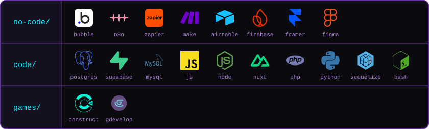
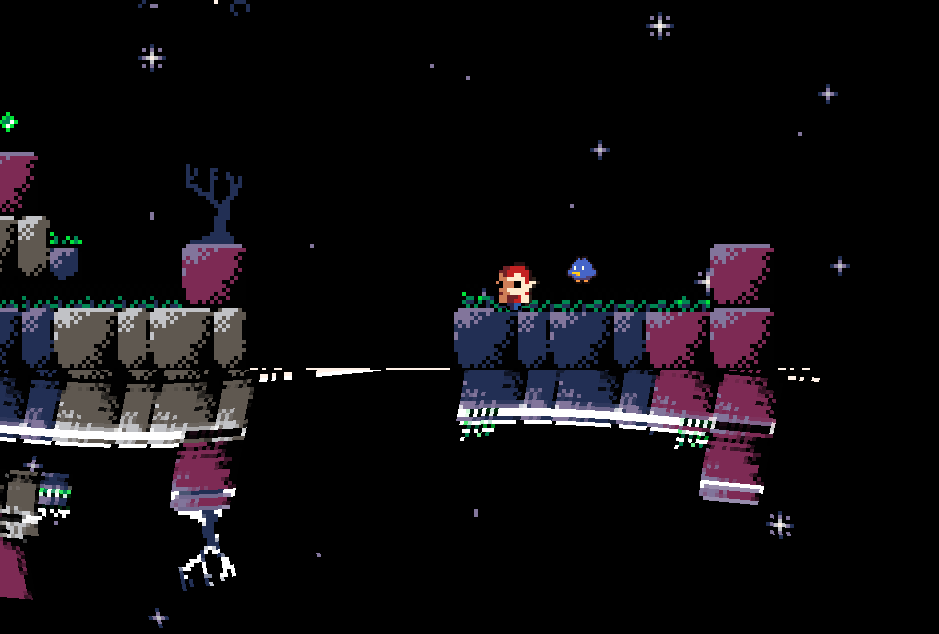
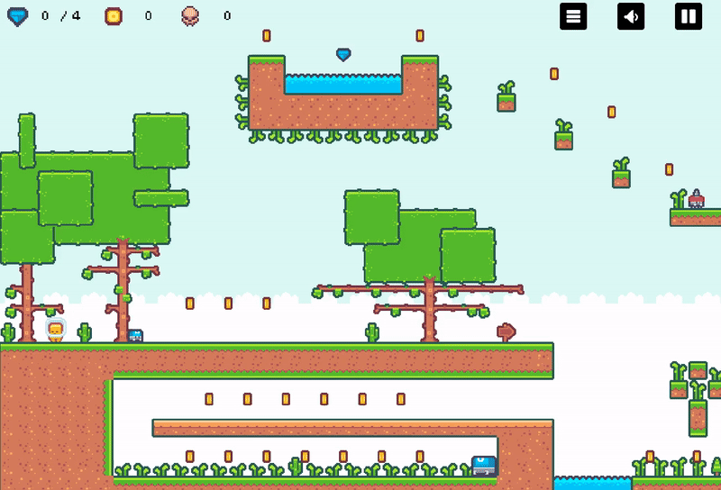

### `~/stack`

  

### `~/games`

  
  
  

  <a href="https://ztf666.itch.io/castelias-might">Castelia's Might</a> ·
  <a href="https://ztf666.itch.io/alien-investigators">Alien Investigators</a> ·
  <a href="https://ztf666.itch.io/knight-of-the-bell">Knight of the Bell</a> ·
  <a href="https://ztf666.itch.io">all on itch.io →</a>

